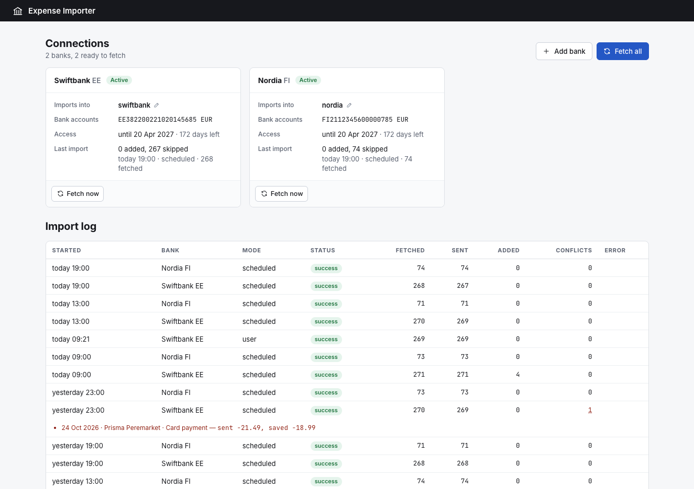

# Expense Importer

Imports bank transactions into [Expense Tracker](https://github.com/raidokaldma/expense-tracker) using
[Enable Banking](https://enablebanking.com), which provides access to most European banks.

It fetches transactions and sends them to Expense Tracker either manually, when you ask in the UI, or automatically,
when a scheduler calls `POST /api/import/fetch` with `{"mode": "scheduled"}`. `compose.example.yaml` includes one,
running at the times in `schedule/crontab`.



## Requirements

An Enable Banking account and an application with its private key, see
[Enable Banking quick start](https://enablebanking.com/docs/api/quick-start/). Register the app's callback URL,
`https://<your-host>/api/import/connections/callback`, as a redirect URL for the application and set it as
`REDIRECT_URL` in `.env`.

## Install with Docker Compose

```sh
cp .env.example .env                   # fill in
cp compose.example.yaml compose.yaml   # adjust for your host
mkdir -p secrets && cp <app-id>.pem secrets/enable-banking.pem
docker compose up -d --build
```

The app is served at `/import`.

## Run locally

Enable Banking only redirects to https, so create a self-signed certificate and set `TLS_CERT_FILE` and
`TLS_KEY_FILE` in `.env`:

```sh
openssl req -x509 -newkey rsa:2048 -nodes -days 825 -subj "/CN=localhost" \
  -addext "subjectAltName=DNS:localhost,IP:127.0.0.1" -keyout secrets/localhost.key -out secrets/localhost.crt
npm install
npm run dev   # https://localhost:3000/import/
```

## License

[MIT](LICENSE)
